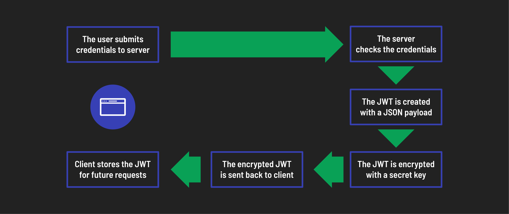
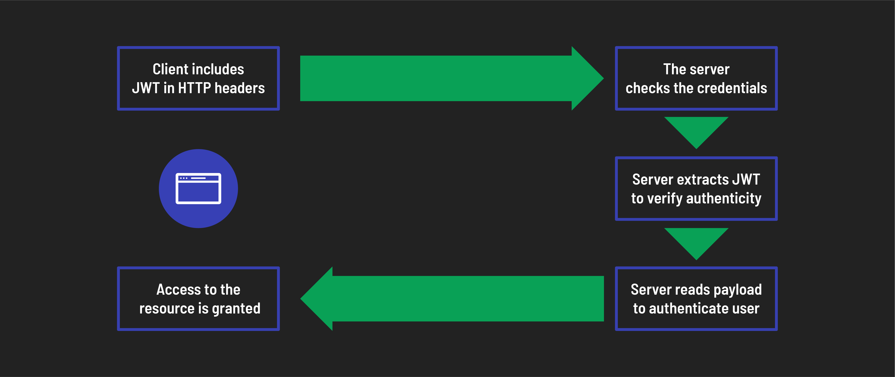

# 

**Learning objective:** By the end of this lesson, learners will be able to explain the process of JWT authentication within a React application, including obtaining, storing, and utilizing JWTs for maintaining secure user sessions.

[JWT (JSON Web Token)](https://jwt.io/introduction) is a popular token-based authentication method used in web applications. Here's an overview of how React applications handle tokens generated by a JWT backend and use them as Authorization Bearer headers in HTTP requests.

## Obtaining the token



1. **Signin form** - In order to obtain a user's login information, the React application presents a sign in form where they can enter their credentials.

2. **API call** - Once the form is submitted, the application sends an API call to the backend using libraries like [Axios](https://axios-http.com/docs/intro) or the [Fetch API](https://developer.mozilla.org/en-US/docs/Web/API/Fetch_API).

   - This call includes the user's credentials in the request body. The backend endpoint responsible for handling login requests receives this data.

3. **Backend authentication** - The backend validates the user's credentials against its database (or other auth mechanisms). If successful, the backend then generates a JWT token. Typically, this token contains user information (such as user ID, roles) and a unique signature to ensure its authenticity and integrity.

4. **Token response** - The backend then sends a response to the React app. This response includes the generated JWT token in the header or body of the response.

   There are a few ways the token can be returned to the client:

   - **JSON format**: Embedded in the response body as a JSON object with a token key
   - **HTTP header**: Included in a custom header like `Authorization` or `X-AuthToken`.

## Storing the token

Once the React app successfully authenticates and receives a JWT token from the server, it is crucial to store this token securely for future use.

We have a few options for how to do this:

### **Local storage**

We can store the token in the browser's local storage to allow access across different pages and sessions, even if we refresh the browser. However, this requires careful security measures because it's highly accessible.

_Example:_

```js
// store
const token = 'your_jwt_token_here'; // token from the server response
localStorage.setItem('jwtToken', token);

// retrieve
const token = localStorage.getItem('jwtToken');
```

### **HTTP cookies**

We can use cookies for token storage. This offers better security but it also adds more complexity due to cookie management.

_Example:_

```bash
npm i js-cookie
```

```js
import Cookies from 'js-cookie';

// store
const token = 'your_jwt_token_here'; // token from the server response
Cookies.set('jwtToken', token, {
  expires: 7,
  secure: true,
  sameSite: 'strict',
});

// retrieve
const token = Cookies.get('jwtToken');
```

### **State management libraries**

Libraries like [Redux](https://redux.js.org/) or [Zustand](https://docs.pmnd.rs/zustand/getting-started/introduction) can provide centralized storage and token access.

## Sending tokens with future requests

Once you have stored the authentication token, you will need to include this token in the headers of subsequent requests to access protected resources. This ensures that each request is authenticated, allowing the server to verify that the requester has the necessary permissions.



Here’s how to include the token using the fetch API in JavaScript:

```javascript
// Retrieve token from preferred storage method
const token = 'your_jwt_token_here';

// Define the headers, including the Authorization header with the token
const options = {
  headers: {
    Authorization: `Bearer ${token}`, // Use the retrieved token
  },
};

// Use fetch to send the request, including the token in the headers
const response = await fetch('/protected-resource', options);
```

## Express and JWT

While we're using Express for our backend in this case, it's important to know that Express plays a generic role and is not essential or unique for this process. Any backend framework with authentication capabilities can serve as the partner in this dance.
